<!--
PROFILE: Geethanjana99 / Geethanjana99
All visual assets are bundled in ./assets. No external image service is required.
Use README-static.md for an entirely motion-free version. Setup: SETUP.md.
The project illustrations are conceptual artwork, not application screenshots.
-->

<picture>
  <source media="(max-width: 650px)" srcset="./assets/mobile/hero.svg">
  <source media="(prefers-reduced-motion: reduce)" srcset="./assets/hero.svg">
  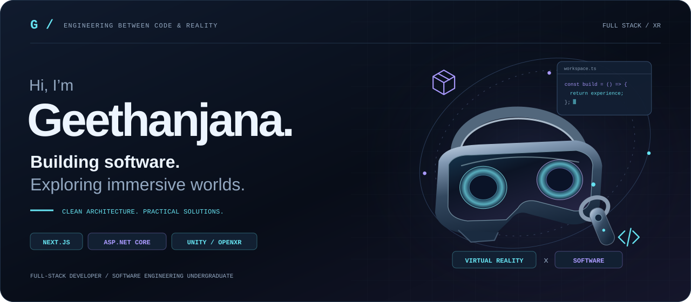
</picture>

<h1 align="center">Full-stack thinking. Immersive possibilities.</h1>

  <strong>Full-Stack Developer at Cogent Solutions</strong> 
  Software Engineering Undergraduate · BSc (Hons) in Industrial Information Technology

  
  <a href="https://www.linkedin.com/in/geethanjana99">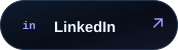</a>
  

  <a href="#about">About</a> &nbsp; / &nbsp;
  <a href="#experience">Experience</a> &nbsp; / &nbsp;
  <a href="#technology">Technology</a> &nbsp; / &nbsp;
  <a href="#selected-projects">Projects</a> &nbsp; / &nbsp;
  <a href="#vr-research">VR Research</a> &nbsp; / &nbsp;
  <a href="#education">Education</a> &nbsp; / &nbsp;
  <a href="#connect">Connect</a>

---

## About

<picture>
  <source media="(max-width: 650px)" srcset="./assets/mobile/section-01.svg">
  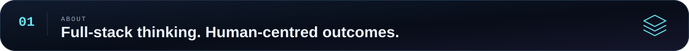
</picture>

<table>
  <tr>
    <td width="34%" valign="top">
      
    </td>
    <td width="66%" valign="top">
      
I’m <strong>Geethanjana</strong>, a developer who enjoys turning real-world problems into practical software. I build web applications, backend systems, and software products with a focus on <strong>clean architecture, maintainable code, and reliable user experiences</strong>.

      
My work connects modern web development with enterprise applications and cloud-based systems. Alongside development, I’m researching how <strong>Virtual Reality can make computer networking concepts more tangible through interactive simulations</strong>.

      
<strong>Currently building:</strong> web-based solutions for the event management industry with Next.js, PHP, and Python.

      
<strong>Experience I bring:</strong> enterprise application development with ASP.NET Core, React, TypeScript, Entity Framework Core, and Microsoft Azure.

      
<strong>Ideas I keep exploring:</strong> cloud computing, software architecture, scalable systems, and immersive learning experiences.

    </td>
  </tr>
</table>

<picture>
  <source media="(max-width: 650px)" srcset="./assets/mobile/developer-console.svg">
  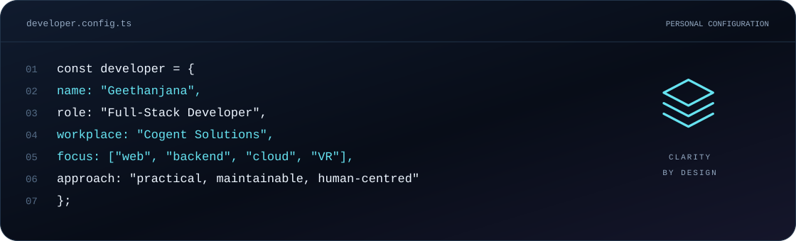
</picture>

<picture>
  <source media="(max-width: 650px)" srcset="./assets/mobile/principles.svg">
  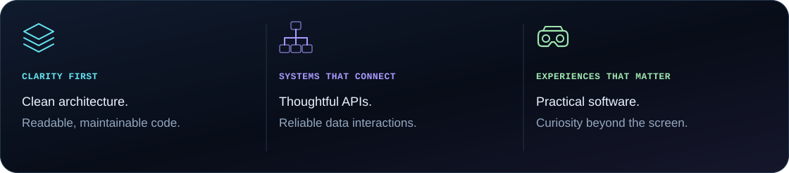
</picture>

## Experience

<picture>
  <source media="(max-width: 650px)" srcset="./assets/mobile/section-02.svg">
  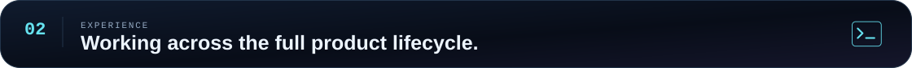
</picture>

### Full-Stack Developer · Cogent Solutions

Developing and maintaining web-based solutions for the **event management industry**, working across frontend interfaces, backend functionality, integrations, databases, and server-side systems.

| Area | My work |
| :--- | :--- |
| Frontend development | Building modern web interfaces with **Next.js**. |
| Backend development | Developing application functionality with **PHP**. |
| Python development | Working on application and data-related tasks. |
| Integrations | Connecting APIs, external services, and application workflows. |
| Data and infrastructure | Working with databases and server-side systems. |
| Product maintenance | Troubleshooting existing applications and improving reliability and usability. |
| Delivery | Contributing across the software development lifecycle. |

<strong>Previous experience / enterprise software and cloud-based systems</strong>

My previous work involved enterprise software built with **ASP.NET Core, React, TypeScript, and Microsoft Azure**, giving me experience across both application development and cloud-based systems.

That experience includes the **TrueMarke electronic signature platform**, with contributions spanning document workflows, PDF processing, audit logging, organization management, and enterprise administration.

## Technology

<picture>
  <source media="(max-width: 650px)" srcset="./assets/mobile/section-03.svg">
  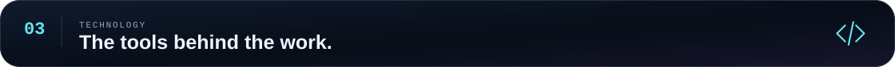
</picture>

### Frontend

<picture>
  <source media="(max-width: 650px)" srcset="./assets/mobile/stack-frontend.svg">
  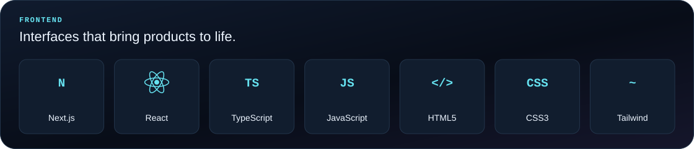
</picture>

### Backend

<picture>
  <source media="(max-width: 650px)" srcset="./assets/mobile/stack-backend.svg">
  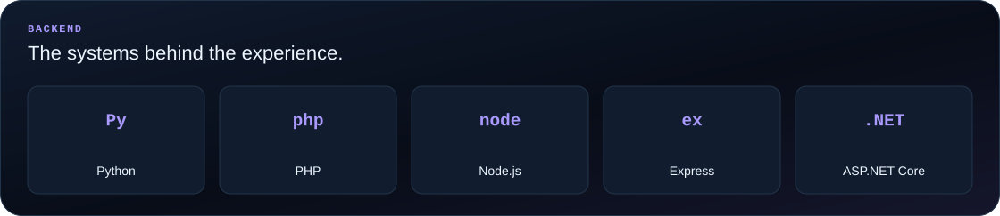
</picture>

### Databases

<picture>
  <source media="(max-width: 650px)" srcset="./assets/mobile/stack-data.svg">
  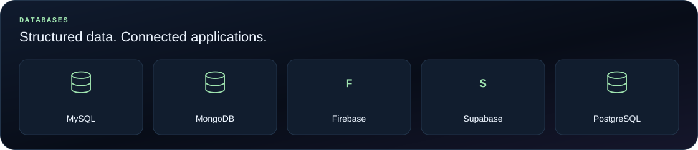
</picture>

### Cloud, DevOps & Tools

<picture>
  <source media="(max-width: 650px)" srcset="./assets/mobile/stack-tooling.svg">
  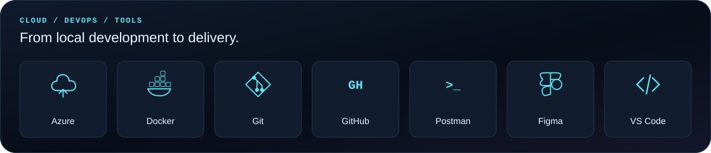
</picture>

### Immersive Technology & Application Foundations

<picture>
  <source media="(max-width: 650px)" srcset="./assets/mobile/stack-xr.svg">
  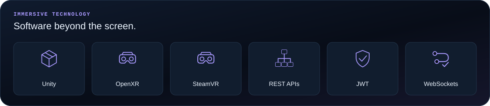
</picture>

**Mobile development:** `React Native` `Expo` `TypeScript` 
**Application foundations:** `Entity Framework Core` `CRUD` `Role-based access control` `Responsive UI`

## Selected Projects

<picture>
  <source media="(max-width: 650px)" srcset="./assets/mobile/section-04.svg">
  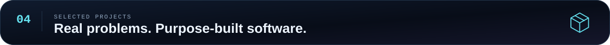
</picture>

### TrueMarke

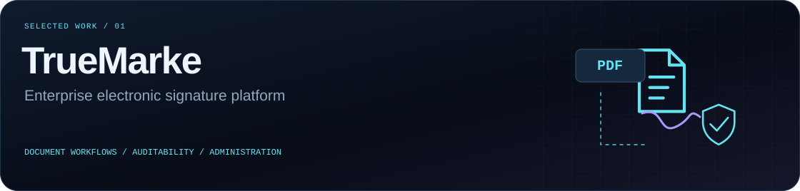

**Enterprise Electronic Signature Platform**

A production-level electronic signature platform designed for real-world business workflows. My contributions covered the document journey as well as the organization, monitoring, and administration features around it.

**Core areas:** electronic signing, PDF processing, document management, auditability, and enterprise administration.

<strong>Explore my contributions</strong>

| Capability | Contribution area |
| :--- | :--- |
| Electronic signing | Electronic document signing workflows. |
| Document handling | PDF processing and document management. |
| Auditability | Audit logging and compliance tracking. |
| Account administration | Organization and user management. |
| Activity visibility | Geolocation-based activity monitoring. |
| Signature records | Digital signature certificate generation. |
| Live monitoring | Real-time document monitoring. |
| Enterprise operations | Enterprise administration features. |

**Stack**

`ASP.NET Core` `Entity Framework Core` `React` `TypeScript` `Microsoft Azure` `Tailwind CSS`

---

### WayPoint

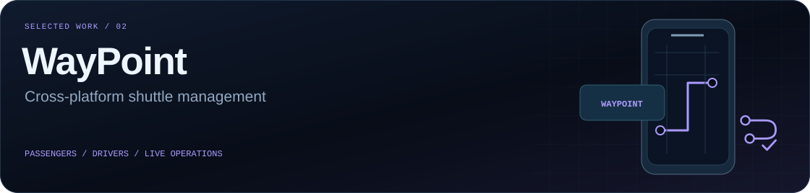

**Shuttle Management System**

A cross-platform transport management application designed for **passengers, drivers, and administrators**, bringing booking, trip management, and live shuttle visibility into one application experience.

**Core areas:** passenger booking, driver operations, real-time tracking, route mapping, and access validation.

<strong>Explore the feature set</strong>

| Experience | Features |
| :--- | :--- |
| Passenger journey | Passenger booking and real-time shuttle tracking. |
| Driver operations | Driver trip management and route mapping. |
| Access and validation | Role-based access control and QR-based validation. |
| Authentication | Biometric authentication. |
| Live connectivity | API and socket integrations. |

**Stack**

`React Native` `TypeScript` `Node.js` `MongoDB` `Expo`

---

### CareSync

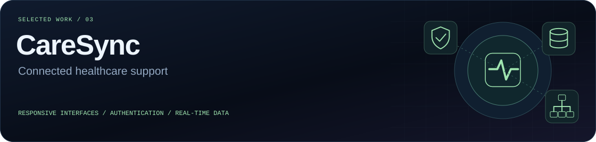

**Healthcare Support System**

A web-based healthcare support platform focused on **responsive interfaces, secure authentication, and real-time data interaction**.

**Core areas:** responsive interfaces across screen sizes, authenticated application access, and connected frontend and backend services.

<strong>Explore the technical focus</strong>

The application brings together a **React** interface, backend functionality using **Node.js, Express, and Python**, and a **MySQL** database. **REST APIs** support application communication, with **JWT** used for authentication.

**Stack**

`React` `Node.js` `Express` `Python` `MySQL` `REST APIs` `JWT`

  

## VR Research

<picture>
  <source media="(max-width: 650px)" srcset="./assets/mobile/section-05.svg">
  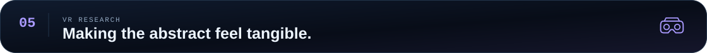
</picture>

### Virtual Reality for Computer Networking Education

<picture>
  <source media="(max-width: 650px)" srcset="./assets/mobile/vr-lab.svg">
  <source media="(prefers-reduced-motion: reduce)" srcset="./assets/vr-lab.svg">
  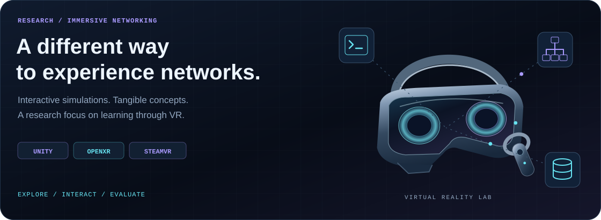
</picture>

I’m currently researching the **development and evaluation of an interactive Virtual Reality learning environment for basic computer networking concepts**.

The project explores how immersive environments can support learning through **interactive simulations**, connecting software development with the design and evaluation of educational experiences.

| Research dimension | Focus |
| :--- | :--- |
| Subject area | Basic computer networking concepts. |
| Learning environment | An interactive Virtual Reality experience. |
| Approach | Immersive simulations that support exploration and interaction. |
| Research scope | Development and evaluation of the learning environment. |

**Research technologies:** `Unity` `OpenXR` `SteamVR`

> The idea is to make networking concepts something learners can explore and interact with—not only something they read about.

## Education

<picture>
  <source media="(max-width: 650px)" srcset="./assets/mobile/section-06.svg">
  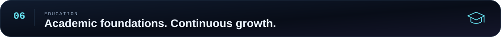
</picture>

### Uva Wellassa University of Sri Lanka

**BSc (Hons) in Industrial Information Technology** 
2022 – 2026

<picture>
  <source media="(max-width: 650px)" srcset="./assets/mobile/academic.svg">
  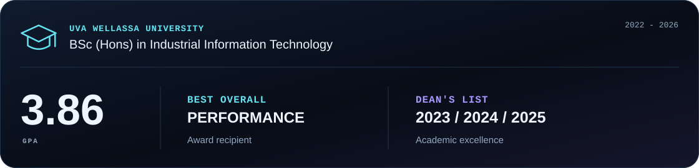
</picture>

**GPA:** 3.86 
**Recognition:** Best Overall Performance award recipient; Dean’s List for academic excellence in 2023, 2024, and 2025.

## Beyond Development

<picture>
  <source media="(max-width: 650px)" srcset="./assets/mobile/section-07.svg">
  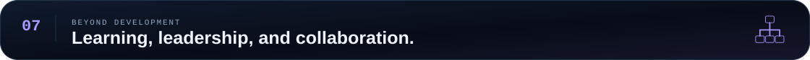
</picture>

### Certifications & Learning

| Learning area | Certification or course |
| :--- | :--- |
| Developer collaboration | GitHub Foundations |
| Containers and delivery | Docker Foundations Professional Certificate |
| Software delivery practices | Agile Software Development |
| Software quality | Test Automation Foundations |

### Leadership & Activities

| Role | Initiative | Period |
| :--- | :--- | :--- |
| Project Chair | IEEE Wellassata AI | 2025 – 2026 |
| Virtual Reality Project Member | UWU Expo | 2025 |
| Mini Organizing Committee | INSL | 2024 |

## GitHub

<picture>
  <source media="(max-width: 650px)" srcset="./assets/mobile/section-08.svg">
  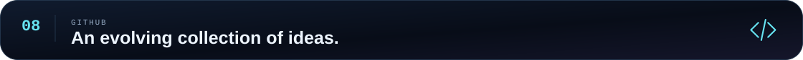
</picture>

<a href="https://github.com/Geethanjana99?tab=repositories">
  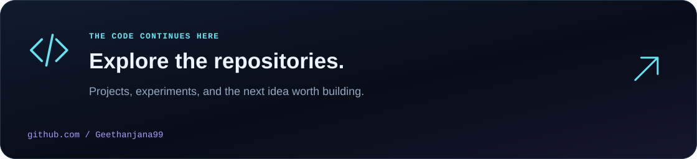
</a>

My repositories are another part of the story: software projects, technical experiments, and the work behind the interfaces.

  <a href="https://github.com/Geethanjana99?tab=repositories">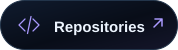</a>

<!-- Optional: the supplied workflow can replace the navigation card above with
     real public GitHub statistics. No statistics are fabricated in this README.
     See SETUP.md before enabling the workflow. -->

## Connect

<picture>
  <source media="(max-width: 650px)" srcset="./assets/mobile/section-09.svg">
  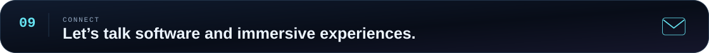
</picture>

I enjoy conversations about **full-stack development, backend systems, clean architecture, cloud computing, and Virtual Reality for education**.

**Have a project, a research idea, or a software problem worth exploring? Let’s connect.**

  
  
  

  <a href="mailto:geethanjana9973@gmail.com">geethanjana9973@gmail.com</a>

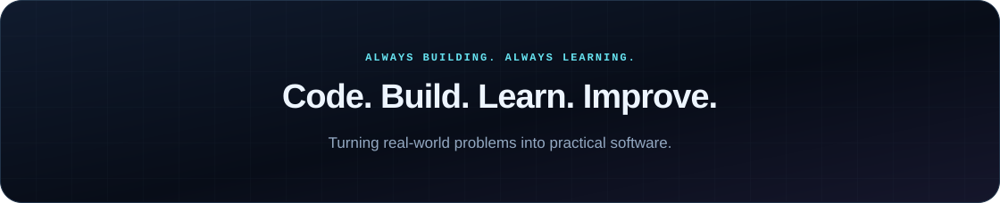
